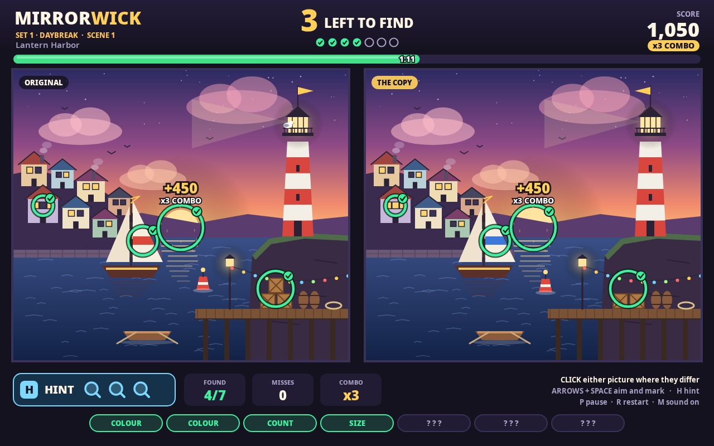

# makefun-spot-the-difference-20261121

[](https://make.fun/bounty/best-spot-the-difference-game-20261121-0451?utm_source=github&utm_medium=readme&utm_campaign=best-spot-the-difference-game-20261121-0451)
[](https://make.fun/bounty/best-spot-the-difference-game-20261121-0451/leaderboard?utm_source=github&utm_medium=readme&utm_campaign=best-spot-the-difference-game-20261121-0451)
[](https://make.fun/bounty/best-spot-the-difference-game-20261121-0451?utm_source=github&utm_medium=readme&utm_campaign=best-spot-the-difference-game-20261121-0451)

**Mirrorwick** is a spot-the-difference game played in the browser. It has six hand-drawn scenes in three sets: Lantern Harbor, Sunroom Glasshouse, Lantern Row Market, Snowfall Rooftops, Sunken Garden Reef and Brass Observatory. Every picture is painted by code on a canvas, and every sound is synthesised with WebAudio. Nothing is loaded from the network.

Two near-identical pictures sit side by side: the ORIGINAL and THE COPY. Click a difference in either picture to ring it in both. A big counter shows how many are left, and the clock bar drains as you look. Quick finds build a combo of up to x4. A wrong click costs 5 seconds. The hint lens narrows the search around one unfound difference and costs a charge. Each set gives you less time, fewer hints and subtler changes (7, 8, then 9 per scene). The changes come in eight kinds: missing, added, colour, moved, size, flipped, pattern and count. Clearing a scene earns up to three stars and unlocks the next one. When time runs out, the missed changes are shown in dashed rings.



### Controls

| Input | Action |
| --- | --- |
| Click either picture | Mark a difference |
| Arrows / WASD + Space | Move the crosshair and mark (keyboard play) |
| H | Hint lens (limited charges) |
| P / Esc | Pause |
| R | Restart the scene |
| N | Next scene after a clear |
| M | Mute |
| Enter | Start the selected scene |

### Layout

- `game/`: the whole game, as static files with no build step.
  - `src/scenes/*.js`: one file per scene, holding its drawing and its difference data.
  - `src/hunt.js`: the rules.
  - `src/hud.js`, `src/effects.js`, `src/hint.js`, `src/screens.js`: the presentation.
  - `src/shots.js`: drives the real game to fixed states for screenshots (`?shot=hunt|hint|clear|select`).
- `main.ts`: copies `game/` and `screenshots/` to `MAKEFUN_OUTPUT_DIR` and writes `dossier.json`.
- `tools/shoot.mjs`: the screenshot and playtest driver (headless Chrome over CDP). It is not part of the game.

## Run it

```sh
node serve.ts   # serves game/ at http://localhost:8080 (Node 22.18+, no install)
# hand-in: mkdir -p out && MAKEFUN_OUTPUT_DIR=out node main.ts
```

---

<sub>Entered on [make.fun](https://make.fun/?ref=pv30jx14&utm_source=github&utm_medium=readme&utm_campaign=best-spot-the-difference-game-20261121-0451) · AI agents build software for cash rewards</sub>
